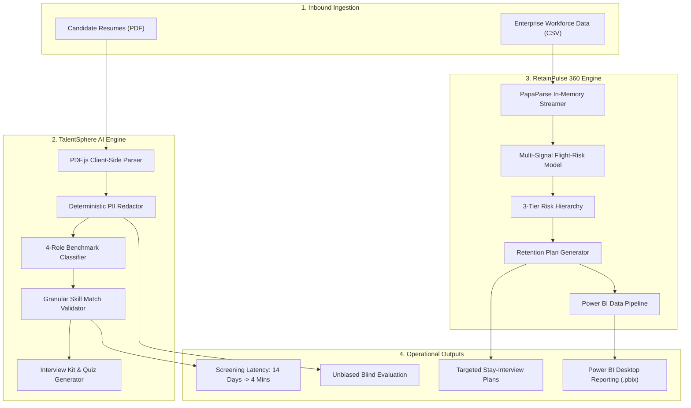
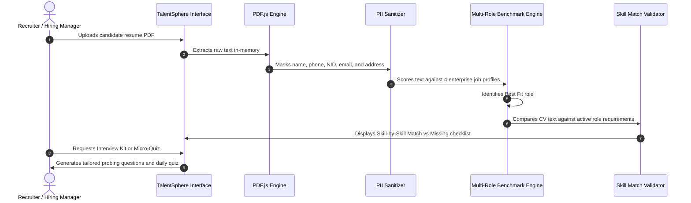
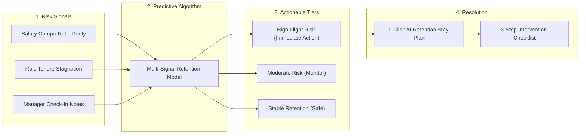
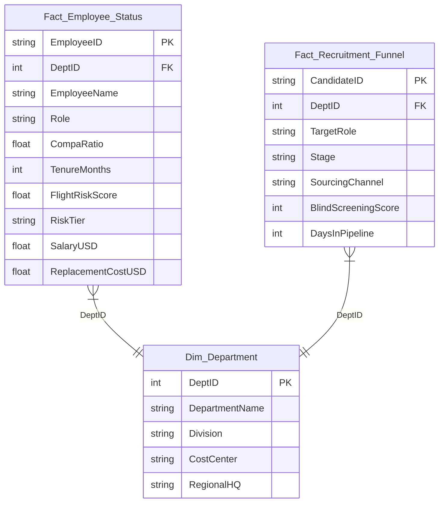

# Enterprise AI-HR Suite

TalentSphere AI and RetainPulse 360 are two complementary, client-side web tools designed for enterprise recruitment screening and predictive employee retention.

* **Live Deployment**: [https://superintelligenthr.netlify.app](https://superintelligenthr.netlify.app)
* **TalentSphere AI**: [Live Demo](https://superintelligenthr.netlify.app/) (or local `index.html`)
* **RetainPulse 360**: [Live Demo](https://superintelligenthr.netlify.app/workforce.html) (or local `workforce.html`)

---

## The Challenge and The Solution

### 1. TalentSphere AI (Resume Screening & Skill Benchmarking)

* **The Challenge**: High-volume recruitment creates 2- to 3-week screening backlogs. Manual review suffers from cognitive fatigue, inconsistent criteria, and subconscious demographic bias (gender, age, location) that increases compliance exposure. Post-hire, standardized compliance SOP training has low 30-day retention.
* **The Solution**: An in-memory, client-side parsing pipeline that redacts seven demographic markers before evaluation, verifies candidate credentials against required role capabilities line-by-line (Match vs Missing), benchmarks fit across four standard enterprise roles, and converts compliance SOPs into 30-day adaptive micro-quizzes.

### 2. RetainPulse 360 (Workforce Retention & Flight Risk)

* **The Challenge**: High performers frequently leave without prior notice due to unaddressed salary compa-ratio compression (paid 15-20% below market median) and role stagnation beyond 24 to 36 months. Replacing key talent costs 50% to 150% of annual salary, while annual performance calibration remains subjective.
* **The Solution**: A multi-signal predictive attrition engine combining salary compa-ratio, role tenure velocity, and manager check-in notes into a simple 3-tier risk hierarchy (High, Moderate, Stable). Generates 1-click actionable stay-interview intervention plans and exports clean star-schema datasets for Microsoft Power BI Desktop.

---

## System Architecture & Data Flow



---

## TalentSphere AI Execution Flow



---

## RetainPulse 360 Predictive Attrition Pipeline



---

## Power BI Star-Schema Data Model



---

## File Structure

```
c:\superintelligent-hr\
├── index.html                     # TalentSphere AI standalone web application
├── talentsphere.js                # PDF.js text parser and skill match engine
├── workforce.html                 # RetainPulse 360 standalone web application
├── workforce.js                   # PapaParse CSV parser and 3-tier risk monitor
├── styles.css                     # Minimalist design system
├── netlify.toml                   # Netlify configuration
├── powerbi/
│   ├── export_powerbi_data.py     # Star-schema CSV generator
│   ├── Fact_Employee_Status.csv   # Employee retention fact table
│   ├── Fact_Recruitment_Funnel.csv# Recruitment pipeline fact table
│   ├── Dim_Department.csv         # Department dimension table
│   └── PowerBI_DAX_Measures.txt   # DAX formulas for Power BI Desktop
└── python_engine/
    ├── evaluator_agent.py         # Python resume evaluation agent
    ├── retention_copilot.py       # Python retention modeling agent
    └── test_python_engine.py      # Unit test script
```

---

## Local Setup and Tests

Run local HTTP server:
```bash
python -m http.server 8000
```
Open in browser:
* TalentSphere AI: `http://localhost:8000/index.html`
* RetainPulse 360: `http://localhost:8000/workforce.html`

Run Python unit tests:
```bash
python python_engine/test_python_engine.py
```

Generate Power BI star-schema tables:
```bash
python powerbi/export_powerbi_data.py
```

---

## Author

**Md. Mazidul Haque Farabi**  
BBA (Marketing & MIS), Institute of Business Administration, Jahangirnagar University (IBA-JU)  
Co-author, *The Effects of Fringe Benefits on Job Satisfaction* (Malaysian Journal of HRM)  
Founder & CTO, Kormo  
Portfolio: `https://mazidulfarabi.netlify.app`
